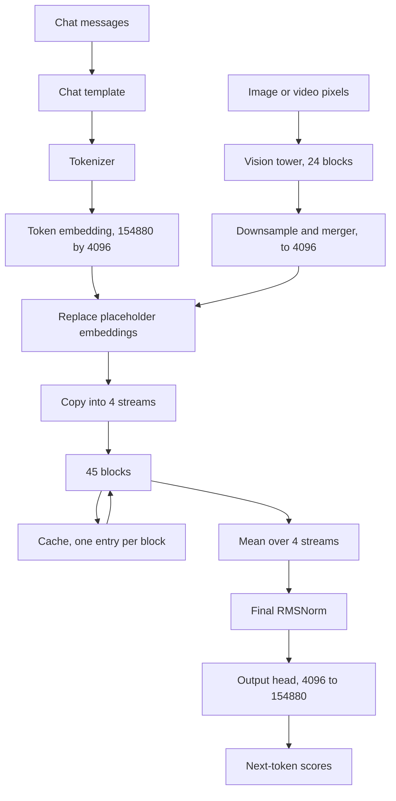
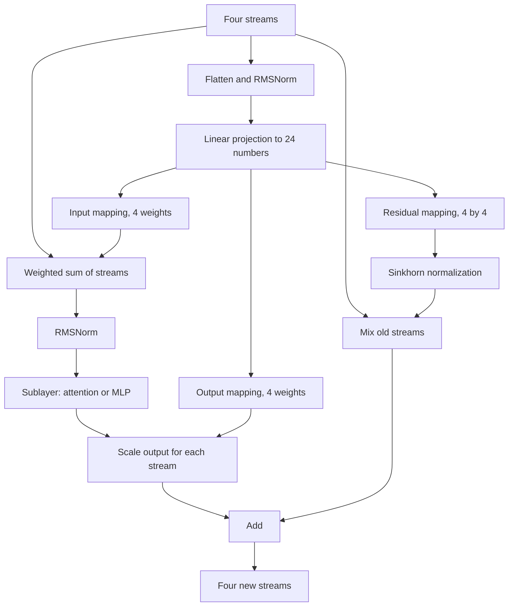
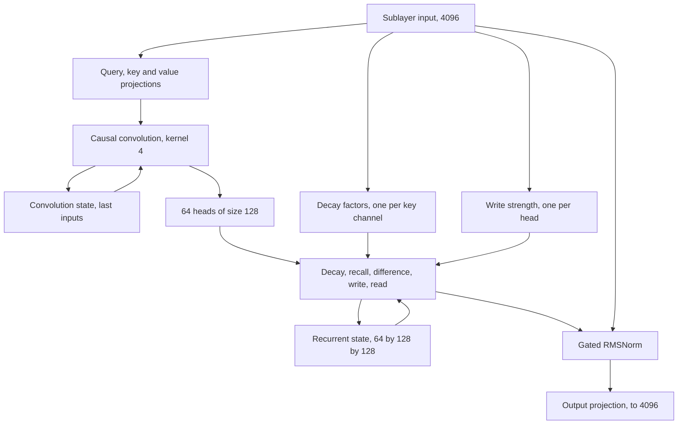
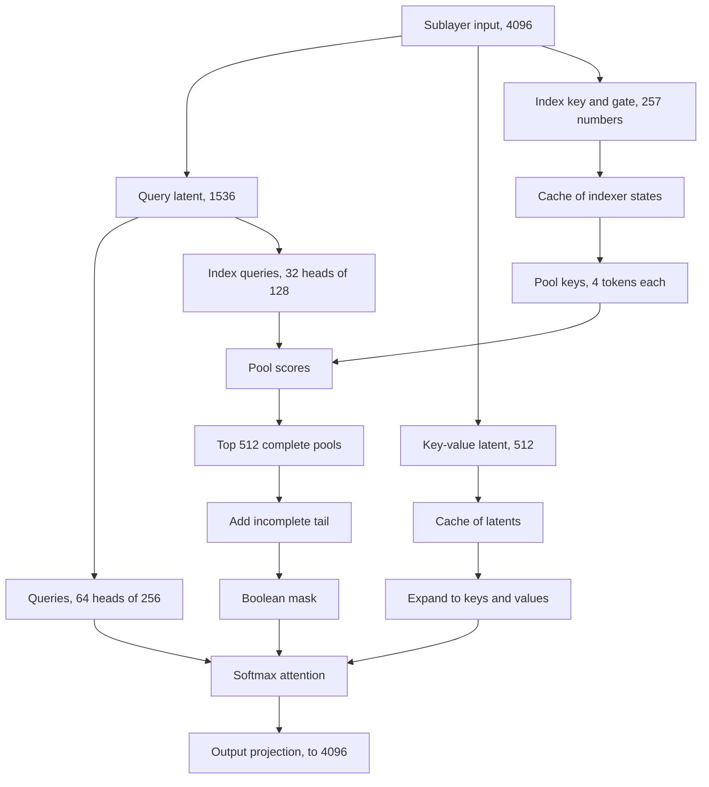
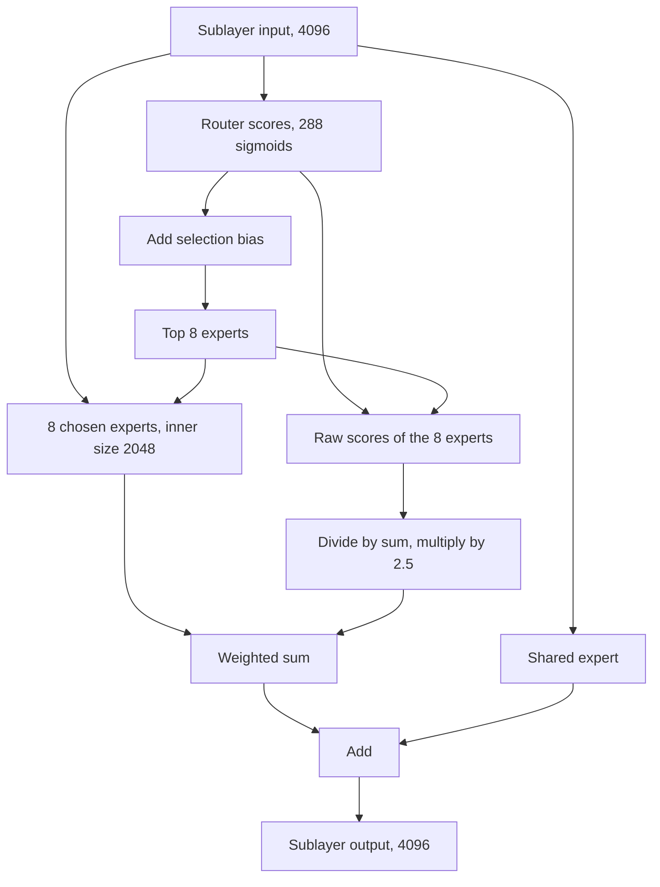

# GLM-5.3-Flash architecture explained

## What this document covers

This document explains how `zai-org/GLM-5.3-Flash` turns a prompt into next-token scores. It follows the pinned Transformers implementation, model type `glm5_next`, from the first embedding to the output head. The reader needs basic transformer knowledge: embeddings, attention, residual connections and an MLP.

The model differs from a standard decoder in four places. It carries four residual streams. It uses two kinds of attention. Most of its MLPs are a mixture of experts. It accepts images and video through a vision tower. Each of these parts gets one section with a diagram, a short program and the output of that program.

### Evidence note

Every statement about model behavior comes from reading two pinned sources. The first is the Transformers source at commit `50e35cc0`. The second is the Hub snapshot of the model at revision `46a050be`, which holds the configuration, the tokenizer, the chat template and the weight index. Citations use short keys such as `M:296-329`, and each one links to the cited lines.

The key letter names the file: M for `modeling_glm5_next.py`, C for `configuration_glm5_next.py`, K for `cache_utils.py`, G for `generation/utils.py`, D for the documentation page, and H for a Hub file.

Nothing in this document ran on the real model. PyTorch and the weight files are absent from the environment used here. The Python examples are small NumPy programs that follow the same steps as the source. Their numbers are illustrative unless the text names a value as a real configuration value. Each output block is the verbatim output of the program above it.

## The model at a glance

The text stack is a decoder with 45 blocks. A block is one decoder layer. Each block holds two sublayers. A sublayer is the attention part or the MLP part of a block. The table lists the numbers that shape everything else.

| Property | Value | Source |
| --- | --- | --- |
| Blocks | 45 | [H:config.json][h-config-json] |
| Hidden size | 4,096 | [H:config.json][h-config-json] |
| Residual streams | 4 | [H:config.json][h-config-json], [C:147-149][c-147-149] |
| Linear attention blocks | 34 | [H:config.json][h-config-json] |
| Sparse attention blocks | 11, at indices 3, 7, 11 and so on to 43 | [H:config.json][h-config-json] |
| Dense MLP blocks | 3, at indices 0 to 2 | [H:config.json][h-config-json], [M:1290-1292][m-1290-1292] |
| MoE blocks | 42, at indices 3 to 44 | [H:config.json][h-config-json] |
| Experts per MoE block | 288 routed, 8 used per token, plus 1 shared | [H:config.json][h-config-json] |
| Vocabulary rows | 154,880 | [H:config.json][h-config-json] |
| Maximum context | 1,048,576 positions | [H:config.json][h-config-json] |
| Stated parameters | 320B total, 18B active | [H:README.md][h-readme-md], [D:32][d-32] |
| Stored weight format | FP8 for most MLP weights, bfloat16 model dtype | [H:config.json][h-config-json] |

The parameter counts in the last rows are statements from the model card. Section "Parameter budget" shows what the pinned shapes add up to.

The flowchart shows the full path. Text tokens and image features meet in one embedding sequence. The sequence becomes four streams, passes through 45 blocks, and collapses back to one vector per position before the output head.



The text stack receives no position signal from outside. The model passes `position_embeddings=None` to every block, and the configuration rejects any rotary dimension above zero [M:1497-1508][m-1497-1508] [C:223-226][c-223-226]. Sections "Linear attention" and "Sparse attention with the indexer" explain where order information comes from instead.

## The block map

All 45 blocks share one layout, but two choices vary by block index. The first choice is the attention kind. The second is the MLP kind. The program below rebuilds both schedules from the two default rules in the configuration class [C:155-172][c-155-172]. The Hub configuration lists the same schedule explicitly.

```python
"""Block map of GLM-5.3-Flash, rebuilt from the two schedule rules in the configuration."""
BLOCKS, DENSE_BLOCKS = 45, 3      # real values: num_hidden_layers, first dense MLP blocks

attention = ["S" if i % 4 == 3 else "L" for i in range(BLOCKS)]   # S sparse, L linear
mlp = ["d" if i < DENSE_BLOCKS else "E" for i in range(BLOCKS)]   # d dense, E mixture of experts

print("block      " + " ".join(f"{i:2d}" for i in range(BLOCKS)))
print("attention  " + " ".join(f" {a}" for a in attention))
print("MLP        " + " ".join(f" {m}" for m in mlp))
print()
print("linear attention blocks:", attention.count("L"))
print("sparse attention blocks:", attention.count("S"), [i for i, a in enumerate(attention) if a == "S"])
print("dense MLP blocks:", mlp.count("d"), " MoE blocks:", mlp.count("E"))
```

```text
block       0  1  2  3  4  5  6  7  8  9 10 11 12 13 14 15 16 17 18 19 20 21 22 23 24 25 26 27 28 29 30 31 32 33 34 35 36 37 38 39 40 41 42 43 44
attention   L  L  L  S  L  L  L  S  L  L  L  S  L  L  L  S  L  L  L  S  L  L  L  S  L  L  L  S  L  L  L  S  L  L  L  S  L  L  L  S  L  L  L  S  L
MLP         d  d  d  E  E  E  E  E  E  E  E  E  E  E  E  E  E  E  E  E  E  E  E  E  E  E  E  E  E  E  E  E  E  E  E  E  E  E  E  E  E  E  E  E  E

linear attention blocks: 34
sparse attention blocks: 11 [3, 7, 11, 15, 19, 23, 27, 31, 35, 39, 43]
dense MLP blocks: 3  MoE blocks: 42
```

The attention schedule repeats every four blocks: three linear attention blocks, then one sparse attention block. The last block, index 44, starts a new group and uses linear attention. The MLP schedule does not repeat. Blocks 0 to 2 use a dense MLP and all later blocks use MoE.

The pinned sources do not state why the ratio is three to one. The Kimi Linear paper uses the same ratio and reports it as its best trade between quality and speed [Kimi Linear paper][kimi]. That paper also motivates the mix. Linear attention is cheap but weak at exact long-range recall, so a periodic attention block with per-token memory covers that gap. The Z.ai guide gives a similar split of roles [Z.ai guide][zai-guide].

Inside every block the order is the same [M:1311-1348][m-1311-1348]:

1. A hyper-connection reads the four streams and builds one sublayer input.
2. RMSNorm and the attention sublayer run on that input.
3. The same hyper-connection writes the result back to the four streams.
4. A second hyper-connection, RMSNorm and the MLP sublayer repeat the pattern.

## Four residual streams

### Why the model keeps four streams

A standard transformer keeps one residual vector per token. Every sublayer reads it and adds its output to it. That fixed "add" is the only way information moves between blocks.

GLM-5.3-Flash keeps four vectors per token instead. A stream is one of these four residual vectors. The streams have shape `[batch, sequence, 4, 4096]`. The model learns, for each token and each sublayer, how to read from the streams and how to write back. The design comes from the mHC paper, which names it manifold-constrained hyper-connections [mHC paper][mhc]. The model card says the design improves scaling efficiency and gives no further detail [H:README.md][h-readme-md].

### How a hyper-connection works

A hyper-connection is the module that computes three sets of weights from the streams. Each sublayer has its own hyper-connection, so the model holds 90 of them [M:1294-1298][m-1294-1298]. The code calls the three sets `pre`, `post` and `comb`. This document uses these names:

| Name here | Code name | Shape per token | Job |
| --- | --- | --- | --- |
| Input mapping | `pre` | 4 | Weights that blend the streams into one sublayer input |
| Output mapping | `post` | 4 | Weights that scale the sublayer output for each stream |
| Residual mapping | `comb` | 4 by 4 | Weights that mix the old streams into the new streams |

The sublayer input is the weighted sum of the four streams. The steps for one sublayer are [M:296-329][m-296-329] [M:1336-1338][m-1336-1338]:

1. Flatten the four streams to one vector of 16,384 values and apply an RMSNorm with no learned weight.
2. Apply one linear projection with no bias. It returns 24 numbers: 4, 4 and 16.
3. Scale each group with a learned scalar and add a learned bias.
4. Input mapping: apply a sigmoid, then add `hc_eps`.
5. Output mapping: apply a sigmoid, then multiply by 2.
6. Residual mapping: apply a softmax over each row, then normalize columns and rows in turn until 20 passes are complete.
7. Sublayer input: sum the streams with the input mapping as weights.
8. Run RMSNorm and the sublayer on the sublayer input.
9. New stream `i` equals output mapping `i` times the sublayer output, plus the mixed old streams.

Step 6 is the Sinkhorn-Knopp procedure. It makes each row and each column of the residual mapping sum to almost exactly 1. The code comment gives the reason: the mixed streams must not grow in size from block to block [M:317-320][m-317-320]. The paper adds that such matrices stay well behaved when many blocks multiply them together [mHC paper][mhc].

All three mappings depend on the token. They are not fixed matrices. The model recomputes them for every token in every sublayer from the current streams.



### Example: what separates identical streams

The four streams start as four copies of the token embedding [M:1494][m-1494]. This raises a question: what makes them different? The program runs one update on four identical streams. The stream count, `hc_eps` and the pass count are real configuration values. The vector size of 3, the raw weights and the sublayer output are illustrative. The program also skips the RMSNorm before the sublayer.

```python
"""One hyper-connection update on four identical streams (toy sizes, illustrative weights)."""
import numpy as np

np.set_printoptions(precision=3, suppress=True)
N, EPS, ITERS = 4, 1e-6, 20                 # real values: hc_mult, hc_eps, hc_sinkhorn_iters
sigmoid = lambda x: 1 / (1 + np.exp(-x))

streams = np.tile([1.0, -2.0, 0.5], (N, 1))             # four copies of one embedding, size 3
rng = np.random.default_rng(0)
raw_input, raw_output = rng.normal(0, 1, (2, N))        # stand-ins for the learned projection
raw_residual = rng.normal(0, 1, (N, N))

input_map = sigmoid(raw_input) + EPS                    # code name: pre
output_map = 2 * sigmoid(raw_output)                    # code name: post
residual_map = np.exp(raw_residual) / np.exp(raw_residual).sum(-1, keepdims=True) + EPS
residual_map /= residual_map.sum(0, keepdims=True) + EPS            # code name: comb
for _ in range(ITERS - 1):
    residual_map /= residual_map.sum(1, keepdims=True) + EPS        # rows
    residual_map /= residual_map.sum(0, keepdims=True) + EPS        # columns

sublayer_output = np.array([0.5, 1.0, -1.0])            # stand-in for attention or the MLP
mixed = residual_map.T @ streams
new_streams = output_map[:, None] * sublayer_output + mixed

print("input mapping   ", input_map, " output mapping", output_map)
print("residual mapping row sums", residual_map.sum(1), " column sums", residual_map.sum(0))
print("sublayer input  ", (input_map[:, None] * streams).sum(0))
print("mixed streams, all four still equal:\n", mixed)
print("new streams = output mapping x sublayer output + mixed:\n", new_streams)
print("readout, mean over streams:", new_streams.mean(0))
```

```text
input mapping    [0.531 0.467 0.655 0.526]  output mapping [0.738 1.179 1.573 1.441]
residual mapping row sums [1. 1. 1. 1.]  column sums [1. 1. 1. 1.]
sublayer input   [ 2.179 -4.359  1.09 ]
mixed streams, all four still equal:
 [[ 1.  -2.   0.5]
 [ 1.  -2.   0.5]
 [ 1.  -2.   0.5]
 [ 1.  -2.   0.5]]
new streams = output mapping x sublayer output + mixed:
 [[ 1.369 -1.262 -0.238]
 [ 1.589 -0.821 -0.679]
 [ 1.787 -0.427 -1.073]
 [ 1.721 -0.559 -0.941]]
readout, mean over streams: [ 1.616 -0.767 -0.733]
```

The mixed streams are still four equal rows. Each new stream is a blend of equal vectors with weights that sum to 1, so mixing cannot separate them. The output mapping is the only source of difference. Each stream receives the same sublayer output at a different strength, from 0.738 to 1.573 in this run.

The input mapping does not sum to 1. Here it sums to about 2.2, so the sublayer input is about 2.2 times one stream. The RMSNorm before the sublayer removes that scale in the real model.

One hyper-connection holds a 24 by 16,384 projection, 24 biases and 3 scales
[M:276-283][m-276-283]. That is 393,243 parameters. The 90 hyper-connections hold 35.4 million
parameters, which is small next to one expert of 25.2 million. The trained values of the mappings are not known here, because the weight files are absent.

## Linear attention

### Why linear attention

Standard attention keeps a key and a value for every past token. Memory and compute per new token grow with the context. At one million tokens this cost is large.

Linear attention replaces the list of past tokens with a state of fixed size. The recurrent state is one matrix per head that summarizes all earlier tokens. Each new token updates the state and reads from it. The cost per token stays the same at any context length. The price is exactness: the state compresses history and can lose details.

GLM-5.3-Flash uses Kimi Delta Attention in 34 of its 45 blocks. The mechanism comes from the Kimi Linear paper [Kimi Linear paper][kimi].

### How one token updates the state

Each head owns a state matrix with 128 rows and 128 columns. A row belongs to one key channel. A column belongs to one value channel. For each token the sublayer produces a key, a value, a query, a decay vector and a write strength. The update follows five steps
[M:500-511][m-500-511]:

1. Decay: multiply each row of the state by its decay factor.
2. Recall: ask the state what it returns for the new key.
3. Difference: subtract that answer from the new value and scale by the write strength.
4. Write: add the difference to the state under the new key.
5. Read: multiply the state by the query to get the output.

Steps 2 to 4 form the delta rule. The state stores only the correction between what it already returns and what the token wants to store. With write strength 1, the key returns exactly the new value after the write. A plain additive memory keeps the old value and adds the new one on top.

The inputs to these steps come from the sublayer input in this way [M:617-771][m-617-771]:

- Three projections map 4,096 values to 8,192 values each, for query, key and value.
- A causal convolution with kernel size 4 runs on each channel separately. Each output sees the current token and the three tokens before it. A SiLU activation follows.
- Query and key get unit length. The query is also divided by the square root of 128.
- The decay factor is `exp(-5 * sigmoid(x))` per head and per key channel [M:359-363][m-359-363]. It lies between 0.0067 and 1, so one step never erases a channel fully.
- The write strength is one sigmoid value per head.
- After the read, a gated RMSNorm and a projection return 4,096 values.



The model has two code paths for the same mathematics. A call with one new token and an existing state uses the token-by-token path. Every other call uses a path that handles 64 tokens at a time [M:737-760][m-737-760]. This document does not verify that the two paths match on the real weights.

### Example: write, overwrite and decay

The program follows one head with a 2 by 2 state. The head count, head size and block count in the last lines are real configuration values. All other numbers are illustrative. Keys have unit length already, and the program leaves out the query scale.

```python
"""Linear attention state for one head: write, overwrite, decay (toy sizes, illustrative values)."""
import numpy as np

np.set_printoptions(precision=2, suppress=True)
state = np.zeros((2, 2))        # rows: key channels, columns: value channels (real: 128 x 128)
query = np.array([1.0, 0.0])    # every step reads with the first key

steps = [  # label, key, value, decay per key channel, write strength
    ("write [2, 4] under key A    ", [1.0, 0.0], [2.0, 4.0], [1.0, 1.0], 1.0),
    ("write [-1, 3] under key B   ", [0.0, 1.0], [-1.0, 3.0], [1.0, 1.0], 1.0),
    ("overwrite key A with [10, 20]", [1.0, 0.0], [10.0, 20.0], [1.0, 1.0], 1.0),
    ("no write, channel 0 decays  ", [0.0, 1.0], [0.0, 0.0], [0.5, 1.0], 0.0),
]
for label, key, value, decay, strength in steps:
    key, value, decay = np.array(key), np.array(value), np.array(decay)
    state = state * decay[:, None]                 # 1. decay each key channel
    recalled = state.T @ key                       # 2. what the state returns for this key
    delta = strength * (value - recalled)          # 3. delta rule: write only the difference
    state = state + np.outer(key, delta)           # 4. rank-one write
    print(f"{label} recalled {recalled}  delta {delta}  read with key A {state.T @ query}")
print("final state:\n", state)
print("additive write at step 3 gives", np.array([2.0, 4.0]) + np.array([10.0, 20.0]))

heads, head_dim, linear_blocks = 64, 128, 34       # real configuration values
values = heads * head_dim * head_dim
print(f"recurrent state per block: {values:,} float32 values = {values * 4 / 2**20:.0f} MiB")
print(f"all {linear_blocks} linear attention blocks: {linear_blocks * values * 4 / 2**20:.0f} MiB")
```

```text
write [2, 4] under key A     recalled [0. 0.]  delta [2. 4.]  read with key A [2. 4.]
write [-1, 3] under key B    recalled [0. 0.]  delta [-1.  3.]  read with key A [2. 4.]
overwrite key A with [10, 20] recalled [2. 4.]  delta [ 8. 16.]  read with key A [10. 20.]
no write, channel 0 decays   recalled [-1.  3.]  delta [ 0. -0.]  read with key A [ 5. 10.]
final state:
 [[ 5. 10.]
 [-1.  3.]]
additive write at step 3 gives [12. 24.]
recurrent state per block: 1,048,576 float32 values = 4 MiB
all 34 linear attention blocks: 136 MiB
```

The four steps show three behaviors:

- Write and read back. After step 1, key A returns `[2, 4]`. Step 2 writes under a different key and does not disturb it.
- Overwrite. In step 3 the state already returns `[2, 4]`, so the difference is `[8, 16]`. Key A then returns `[10, 20]`, not the additive result `[12, 24]`.
- Decay. Step 4 writes nothing. The decay factor 0.5 on channel 0 halves what key A returns. Channel 1 keeps its content.

### What the state size implies

One block stores 64 times 128 times 128 values, which is 4 MiB in float32
[M:763][m-763]. All 34 blocks together store 136 MiB per sequence. A second small state holds
the last inputs of the convolution, 24,576 channels by 4 positions
[K:1192-1230][k-1192-1230]. Neither state grows with the context.

Three consequences follow from this design:

- Memory is constant. A context of one million tokens uses the same linear attention state as a context of one thousand.
- Recall is approximate. A head has 128 key channels, so only 128 keys can sit in the state without overlap. Keys that overlap disturb each other, and decay removes old content by design.
- Order comes from the mechanism. The sublayer receives no position input [M:664-670][m-664-670]. The convolution sees four neighboring tokens in order, and later writes act on a state that earlier writes already changed.

## Sparse attention with the indexer

### Why sparse attention

Linear attention cannot return an exact copy of a distant token. Eleven blocks therefore use attention with a per-token memory. Full attention over one million tokens is too costly, so each query attends to a limited set of earlier tokens.

Sparse attention is attention restricted to tokens that a selector picked. The indexer is that selector: a small scoring module inside each sparse attention block. The idea comes from DeepSeek-V3.2 [DeepSeek-V3.2 paper][dsv32]. GLM-5.3-Flash changes one thing. Its indexer scores pools, not single tokens. A pool is a group of four consecutive tokens
[M:860-867][m-860-867]. The Z.ai guide calls this IndexPool [Z.ai guide][zai-guide].

### How the attention part works

The attention part compresses keys and values before it caches them. A latent is the compressed vector that stands for one token's keys and values. The steps are
[M:1175-1236][m-1175-1236]:

1. Query path: project the sublayer input to 1,536 values, apply RMSNorm, then expand to 64 heads of size 256.
2. Latent path: project the sublayer input to 512 values and apply RMSNorm.
3. Cache: append the 512-value latent to the cache [M:1195-1197][m-1195-1197].
4. Expand: one projection turns every cached latent into keys and values for 64 heads.
5. Attend: run softmax attention under the mask from the indexer.
6. Project the 16,384 output values back to 4,096.

This low-rank layout matches the multi-head latent attention of DeepSeek-V3 [DeepSeek-V3 paper][dsv3]. The rotary half of that design is absent here, because the configuration enforces a rotary size of zero [C:223-226][c-223-226].

### How the indexer selects tokens

For each query the indexer returns a list of token positions [M:811-914][m-811-914]:

1. Per-token state: compute a 128-value index key and a 128-value gate vector for each token. Store both, plus a validity flag, in the cache. That is 257 numbers per token.
2. Pooling: group valid tokens in fours, starting at the first valid token. Blend the four index keys with a softmax over the gate values [M:936-1009][m-936-1009].
3. Scoring: compare 32 index queries with each pool key, apply ReLU, and sum the heads with weights that depend on the query token [M:860-867][m-860-867].
4. Candidates: a pool is a candidate only if it is complete and its last token is not after the query [M:870-881][m-870-881].
5. Selection: keep the 512 pools with the highest scores. They expand to 2,048 tokens [M:882-901][m-882-901].
6. Tail: always add the tokens of the incomplete last pool, at most 3 [M:1011-1061][m-1011-1061].
7. Mask: turn the list into a boolean mask over all cached tokens [M:1238-1276][m-1238-1276].

The count 512 is `index_topk` divided by `index_kpool`, which is 2,048 divided by 4. The widest possible list holds 2,051 positions [M:903-906][m-903-906].



### Example: pool selection and the selection budget

The first part of the program uses a toy budget of two pools and three illustrative pool scores. The second part applies the selection formula with the real values 4 and 2,048.

```python
"""Pool selection of the indexer (toy budget), then the budget formula with real values."""
import numpy as np

POOL, TOPK = 4, 8                     # toy budget: 8 // 4 = 2 pools. Real values: 4 and 2048
visible = 14                          # tokens 0..13 are visible to the query at position 13
pool_scores = np.array([3.1, 0.2, 0.4])            # illustrative scores of the complete pools

complete_pools = visible // POOL
keep = np.sort(np.argsort(-pool_scores[:complete_pools])[: TOPK // POOL])
from_pools = [int(p) * POOL + m for p in keep for m in range(POOL)]
tail = list(range(complete_pools * POOL, visible))  # the incomplete last pool is always kept
selected = from_pools + tail
print("pools kept:", keep.tolist(), " tokens from pools:", from_pools, " tail:", tail)
print("mask row:  ", [int(t in selected) for t in range(visible)])
print("dropped:   ", [t for t in range(visible) if t not in selected])

def attended(n, pool=4, topk=2048):
    return min(n // pool, topk // pool) * pool + n % pool

print()
for n in (4, 2048, 2051, 2052, 2055, 100_000, 1_048_576):
    print(f"visible {n:>9,}  pools {n // 4:>7,}  attended {attended(n):>5,}  all visible kept: {attended(n) == n}")
```

```text
pools kept: [0, 2]  tokens from pools: [0, 1, 2, 3, 8, 9, 10, 11]  tail: [12, 13]
mask row:   [1, 1, 1, 1, 0, 0, 0, 0, 1, 1, 1, 1, 1, 1]
dropped:    [4, 5, 6, 7]

visible         4  pools       1  attended     4  all visible kept: True
visible     2,048  pools     512  attended 2,048  all visible kept: True
visible     2,051  pools     512  attended 2,051  all visible kept: True
visible     2,052  pools     513  attended 2,048  all visible kept: False
visible     2,055  pools     513  attended 2,051  all visible kept: False
visible   100,000  pools  25,000  attended 2,048  all visible kept: False
visible 1,048,576  pools 262,144  attended 2,048  all visible kept: False
```

In the toy part, three complete pools compete for two places. Pool 1 has the lowest score, so tokens 4 to 7 drop out as a group. Tokens 12 and 13 form the incomplete tail and stay.

The second part shows the 2,051-token threshold. A query that sees at most 2,051 tokens attends to every one of them. In that range the block behaves like full attention. At 2,052 visible tokens there are 513 complete pools, and one pool drops out. At the maximum context a query still attends to at most 2,051 tokens.

One edge case follows from the candidate rule. When the visible count is a multiple of 4, the query's own token sits in a complete pool. That pool must win a place like any other. Beyond the threshold, a query can therefore miss its own position in such a block.

### What the cache stores and what the selection saves

Each sparse attention block stores 769 numbers per token: the 512-value latent and the 257-value indexer state. The cache grows with the context. Keys and values in expanded form hold 32,768 numbers per token, so the latent saves memory by a factor of 64.

In the pinned code the selection is only a mask. The block still expands every cached latent and computes attention scores against all cached tokens [M:1199][m-1199] [M:1219-1232][m-1219-1232]. The pinned sources therefore show the selection rule, not a compute saving. The Z.ai guide reports lower attention compute for its own serving stack [Z.ai guide][zai-guide].

The configuration allows a block to reuse the selection of an earlier block
[M:1150-1154][m-1150-1154]. The IndexCache paper describes that idea [IndexCache paper][indexcache].
This model does not use it: all 45 entries of `indexer_types` are `full`
[H:config.json][h-config-json].

Attention scores in these blocks depend on content only. Order reaches a sparse attention block through the streams, which earlier linear attention blocks shaped, and through the causal candidate rule.

## Feed-forward: dense MLP and mixture of experts

### Why a mixture of experts

The MLP sublayers hold most of the parameters of a large model. A mixture of experts (MoE) splits one large MLP into many smaller MLPs, called experts. Each token uses only a few of them. The model can then hold far more parameters than it runs for any single token.

The router is the part that picks the experts for a token. GLM-5.3-Flash follows the DeepSeek-V3 form of MoE with sigmoid scores and one shared expert that every token uses [DeepSeek-V3 paper][dsv3].

### The dense MLP

Blocks 0 to 2 use one dense MLP [M:85-104][m-85-104]. It is a gated design with three projections and no bias:

- `gate` and `up` map 4,096 values to 12,288 values each.
- The output is `down(silu(gate) * up)`, back at 4,096 values.
- Two clamps limit extreme values. The gate input stays at or below 10. The up input stays between -10 and 10.

The pinned sources do not say why the first three blocks are dense. Their cost is small: 0.45B parameters out of roughly 306B in all MLP sublayers.

### The router and the experts

Blocks 3 to 44 use MoE [M:185-207][m-185-207]. Each expert is a gated MLP like the dense one, with an inner size of 2,048. The steps for one token are [M:158-182][m-158-182]:

1. Score: multiply the sublayer input by the router weight in float32. Apply one sigmoid per expert. Each of the 288 scores is independent of the others.
2. Choose: add a stored bias to each score, then take the 8 highest.
3. Weigh: take the 8 raw scores without the bias. Divide by their sum, then multiply by 2.5.
4. Run the 8 chosen experts and sum their outputs with these weights [M:106-142][m-106-142].
5. Run the shared expert on the same input and add its output [M:199-206][m-199-206].

The bias in step 2 changes which experts win, but never the weight of a winner. The 8 weights always sum to 2.5, while the shared expert has weight 1. The MoE sublayer returns only this sum. The hyper-connection adds the result to the streams afterward.



### Example: one routing decision

The program routes one token among 6 experts and keeps 2. The scale 2.5 is a real configuration value. The token, the router weight and the bias are illustrative.

```python
"""Router of one MoE block for one token (toy sizes, illustrative weights)."""
import numpy as np

np.set_printoptions(precision=4, suppress=True)
TOP_K, SCALE = 2, 2.5                       # real values: 8 experts per token, scale 2.5
token = np.array([2.0, 0.0, -1.0, 0.5])     # sublayer input, size 4 (real: 4096)
router_weight = np.array([[1.0, 0.0, 0.0, 0.0],      # one row per expert (real: 288 rows)
                          [0.0, 1.0, 0.0, 0.0],
                          [0.0, 0.0, -1.0, 0.0],
                          [0.0, 0.0, 0.0, 1.0],
                          [0.4, 0.5, 0.0, 0.0],
                          [-1.0, 0.0, 0.0, 0.4]])
selection_bias = np.array([0.0, 0.0, 0.0, 0.15, 0.0, 0.0])   # e_score_correction_bias

scores = 1 / (1 + np.exp(-(router_weight @ token)))          # one sigmoid per expert
chosen = np.sort(np.argsort(-(scores + selection_bias))[:TOP_K])
weights = scores[chosen] / scores[chosen].sum() * SCALE      # raw scores, bias not included

print("scores             ", scores)
print("scores plus bias   ", scores + selection_bias)
print("chosen experts     ", chosen, " without the bias:", np.sort(np.argsort(-scores)[:TOP_K]))
print("expert weights     ", weights, " sum", round(float(weights.sum()), 4))
```

```text
scores              [0.8808 0.5    0.7311 0.6225 0.69   0.1419]
scores plus bias    [0.8808 0.5    0.7311 0.7725 0.69   0.1419]
chosen experts      [0 3]  without the bias: [0 2]
expert weights      [1.4648 1.0352]  sum 2.5
```

Without the bias, the token picks experts 0 and 2. The bias of 0.15 lifts expert 3 above expert 2, so the token picks experts 0 and 3. The weight of expert 3 still uses its raw score 0.6225. The two weights sum to 2.5.

A routing decision depends only on that token's sublayer input in that block. Because the 8 scores are divided by their sum, only their ratios reach the output.

### Parameter budget

The program adds up parameters from the configuration values and the module shapes in the pinned code. The two attention totals per sublayer come from the same shape arithmetic. The "per token" column counts the parameters that one token passes through. It counts the full embedding table and output head.

```python
"""Parameter arithmetic for the text stack, from configuration values and module shapes."""
H, VOCAB = 4096, 154880
dense_mlp = 3 * H * 12288                          # gate, up and down projections
expert = 3 * H * 2048                              # one routed or shared expert
router = 288 * H
moe = 288 * expert + expert + router
moe_active = 8 * expert + expert + router          # 8 routed experts, shared expert, router
linear_attn, sparse_attn = 137_732_288, 124_914_432   # per sublayer, summed from module shapes
hyper = 2 * (24 * 4 * H + 24 + 3)                  # two hyper-connections per block
norms = 2 * H                                      # two RMSNorm weights per block

rows = [  # name, parameters in all blocks, parameters one token uses
    ("dense MLP, 3 blocks", 3 * dense_mlp, 3 * dense_mlp),
    ("MoE, 42 blocks", 42 * moe, 42 * moe_active),
    ("linear attention, 34 blocks", 34 * linear_attn, 34 * linear_attn),
    ("sparse attention, 11 blocks", 11 * sparse_attn, 11 * sparse_attn),
    ("hyper-connections and norms", 45 * (hyper + norms), 45 * (hyper + norms)),
    ("embedding and output head", 2 * VOCAB * H, 2 * VOCAB * H),
]
for name, total, active in rows:
    print(f"{name:30s} {total / 1e9:9.3f} B total {active / 1e9:8.3f} B per token")
total, active = sum(r[1] for r in rows), sum(r[2] for r in rows)
print(f"{'text stack, 45 blocks':30s} {total / 1e9:9.3f} B total {active / 1e9:8.3f} B per token")
print(f"one MoE block {moe / 1e9:.3f} B, one token uses {moe_active / moe:.2%} of it")
unused = moe + sparse_attn + norms                 # block 45 in the checkpoint, sizes assumed equal
print(f"with the unused block 45: {(total + unused) / 1e9:.3f} B")
print(f"index bytes per stated parameter: {328_326_771_576 / 320e9:.3f}")
```

```text
dense MLP, 3 blocks                0.453 B total    0.453 B per token
MoE, 42 blocks                   305.512 B total    9.562 B per token
linear attention, 34 blocks        4.683 B total    4.683 B per token
sparse attention, 11 blocks        1.374 B total    1.374 B per token
hyper-connections and norms        0.036 B total    0.036 B per token
embedding and output head          1.269 B total    1.269 B per token
text stack, 45 blocks            313.327 B total   17.377 B per token
one MoE block 7.274 B, one token uses 3.13% of it
with the unused block 45: 320.726 B
index bytes per stated parameter: 1.026
```

MoE holds about 97.5% of the text stack, and one token uses 3.13% of each MoE block. A linear attention sublayer holds 137.7M parameters. A sparse attention sublayer holds 124.9M, of which the indexer holds 7.5M.

These totals do not reproduce the model card. The card states 320B total and 18B active
[H:README.md][h-readme-md]. The pinned shapes give 313.3B and 17.4B for the 45 loaded blocks, without
the vision tower. Adding the unused block from the checkpoint gives 320.7B, under the assumption that it matches a normal block in size. How the card counts is not stated. The weight index lists names only, so tensor shapes are not verified here.

## Readout and the unused multi-token prediction block

### Readout

After block 44 the model must return to one vector per token. The readout takes the plain mean of the four streams [M:332-337][m-332-337]. It has no learned weights. A final RMSNorm follows
[M:1510][m-1510]. The output head is one linear projection from 4,096 to 154,880 values with no
bias [M:2150][m-2150]. It does not share weights with the embedding table, because `tie_word_embeddings` is false [H:config.json][h-config-json].

### The extra block in the checkpoint

The weight index lists 46 block indices, 0 to 45, but the model builds 45 blocks. Index 45 holds 1,760 tensors [H:model.safetensors.index.json][h-model-safetensors-index-json]. The loader ignores every key under `layers.45.` [M:1376-1379][m-1376-1379], and the documentation page says the implementation does not include an MTP layer [D:26][d-26].

MTP means multi-token prediction: an extra block trained to predict one token further ahead. DeepSeek-V3 describes such a module [DeepSeek-V3 paper][dsv3]. The tensor names under index 45 fit that description. They include a sparse attention sublayer, an MoE sublayer, and four names found nowhere else: `eh_proj`, `enorm`, `hnorm` and `shared_head.norm`. Index 45 has no hyper-connection tensors. This reading rests on names only. The wiring of that block is not verified.

## Vision path

### Why a separate path

The decoder works on vectors of size 4,096. An image must become a sequence of such vectors before the decoder can read it. A vision tower does this work, and its output replaces placeholder embeddings in the text sequence. The pinned sources contain the tower but not the image processor, so resize rules are not verified.

### From pixels to image tokens

The steps are [M:1798-1878][m-1798-1878]:

1. Patch embedding: a 3D convolution maps each patch of 2 frames by 14 by 14 pixels to 1,024 values [M:1717-1735][m-1717-1735].
2. Vision blocks: 24 blocks of RMSNorm, attention and a gated MLP run at width 1,024. Attention is not causal and uses a 2D rotary position code [M:1599-1715][m-1599-1715].
3. Downsample: a 2 by 2 convolution merges four neighboring patches into one vector of 4,096 values.
4. Merger: a projection, LayerNorm, GELU and a gated MLP refine each vector [M:1534-1555][m-1534-1555].
5. Fusion: the model writes the vectors over the embeddings at placeholder positions [M:1990-2044][m-1990-2044]. A mismatch between vectors and placeholders raises an error.

The token count for one image is the patch grid size divided by 4 [M:1929-1932][m-1929-1932]. The program below does this arithmetic for a 448 by 448 image. The same program prints cache sizes that Section "Cache and state" uses.

```python
"""Vision token count for one image, and cache growth per text token (real configuration values)."""
image, patch, merge = 448, 14, 2
side = image // patch
print(f"patches per side {side}, patches {side * side}, image tokens {side * side // merge**2}")
print(f"values per flattened patch: {3 * 2 * patch * patch}")

latent, indexer = 512, 128 + 128 + 1          # sparse block: key-value latent, indexer state
sparse_blocks, linear_blocks = 11, 34
per_token = sparse_blocks * (latent + indexer)
print(f"sparse blocks store {latent + indexer} numbers per token, {per_token:,} over {sparse_blocks} blocks")
print(f"expanded keys and values per token and block: {64 * (256 + 256):,}")
fixed = linear_blocks * (64 * 128 * 128 + 3 * 64 * 128 * 4)
for tokens in (1_000, 100_000, 1_048_576):
    print(f"context {tokens:>9,}: sparse blocks {tokens * per_token:>13,} numbers, linear blocks {fixed:,} numbers")
```

```text
patches per side 32, patches 1024, image tokens 256
values per flattened patch: 1176
sparse blocks store 769 numbers per token, 8,459 over 11 blocks
expanded keys and values per token and block: 32,768
context     1,000: sparse blocks     8,459,000 numbers, linear blocks 38,993,920 numbers
context   100,000: sparse blocks   845,900,000 numbers, linear blocks 38,993,920 numbers
context 1,048,576: sparse blocks 8,869,904,384 numbers, linear blocks 38,993,920 numbers
```

A 448 by 448 image gives 32 patches per side, 1,024 patches and 256 image tokens. This holds only if the processor keeps the image at 448 by 448. The processor configuration allows 16 to 8,000 tokens per image [H:processor_config.json][h-processor-config-json].

Video uses the same tower. The model treats each pair of frames as its own image
[M:1899-1921][m-1899-1921]. In the prompt, image and video features both land on positions with the
image placeholder id 154854. The code tells them apart by the begin and end markers around them [M:1936-1988][m-1936-1988].

## Tokens and prompt format

### Vocabulary and special tokens

The embedding table has 154,880 rows. The tokenizer defines 154,820 base entries and 36 added tokens with ids 154820 to 154855 [H:tokenizer.json][h-tokenizer-json]. The remaining 24 rows have no token.

| Token | Id | Role |
| --- | --- | --- |
| `<\|endoftext\|>` | 154820 | End of text and padding |
| `[gMASK]`, `<sop>` | 154822, 154824 | Fixed prompt prefix |
| `<\|user\|>` | 154827 | Starts a user turn |
| `<\|assistant\|>` | 154828 | Starts an assistant turn |
| `<\|observation\|>` | 154829 | Starts a tool result |
| `<think>`, `</think>` | 154841, 154842 | Wrap reasoning text |
| `<\|image\|>`, `<\|video\|>` | 154854, 154855 | Placeholders for vision features |

Generation stops at any of three ids: 154820, 154827 or 154829
[H:generation_config.json][h-generation-config-json]. The model therefore stops when it starts a user turn or a
tool result. Padding goes on the left for batched generation [D:40][d-40].

### A rendered prompt

The chat template has a fixed shape [H:chat_template.jinja][h-chat-template-jinja]. It starts with `[gMASK]<sop>`. It always adds a system turn that names the reasoning effort. It puts no line breaks between turns. The generation prompt ends with an open `<think>` tag, so the model writes reasoning first.

The data example uses four messages:

| Role | Content |
| --- | --- |
| system | `Be brief.` |
| user | one image, then `What is this?` |
| assistant | reasoning `A cat photo.`, reply `A cat.` |
| user | `Thanks. And 2+2?` |

The Hub template, rendered with Jinja2 3.1.6 and default options, gives this string:

```text
[gMASK]<sop><|system|>Reasoning Effort: Max<|system|>Be brief.<|user|><|begin_of_image|><|image|><|end_of_image|>What is this?<|assistant|><think>A cat photo.</think>A cat.<|user|>Thanks. And 2+2?<|assistant|><think>
```

This render used Jinja2 directly, not the `apply_chat_template` method. The template accepts `reasoning_effort` values `low`, `high` and `max`, and any other value becomes `max`. With `clear_thinking=True`, the earlier reasoning renders as `<think></think>`. The single `<|image|>` in the string stands for all image tokens. The processor expands it to the real count, and that code is not in the pinned sources.

## Cache and state

### What each block stores

During generation the model reuses work from earlier tokens through a cache. The default cache holds one entry per block, and the entry type follows the attention kind
[M:1461-1462][m-1461-1462] [K:1967-1974][k-1967-1974]. The MLP sublayers and the hyper-connections store nothing.

| | Linear attention block | Sparse attention block |
| --- | --- | --- |
| Count | 34 | 11 |
| Stored | Recurrent state and convolution state | Latents and indexer states |
| Size | 1,146,880 numbers per block, fixed | 769 numbers per token per block |
| Update | Overwrites the state in place [K:1232-1246][k-1232-1246] | Appends one row per token [M:1195-1197][m-1195-1197] |
| Remove last tokens | Not possible for the recurrent state [K:1126-1151][k-1126-1151] | Possible, the entry slices its rows [K:377-385][k-377-385] |
| Reports itself as croppable | No, once a recurrent state exists [K:1107-1116][k-1107-1116] | Yes |

The last output lines of the program in Section "Vision path" compare the two totals. At 1,000 tokens the linear attention blocks hold more numbers. At the maximum context the sparse attention blocks hold about 8.9 billion numbers, and the linear attention blocks still hold 39 million.

### Why rollback is not possible with the default cache

Some decoding methods propose tokens, check them, and reject some. They then need the cache as it was before the rejected tokens. A sparse attention entry can do this by dropping rows. A linear attention entry cannot, for three reasons that the source shows:

- The recurrent state is one tensor. Each step overwrites it, and no earlier copy exists [K:1232-1246][k-1232-1246].
- The `crop` method of a linear attention entry trims only the convolution state [K:1126-1151][k-1126-1151].
- The cache as a whole reports itself as croppable only if every entry does [K:1851-1853][k-1851-1853].

The model class sets `_is_stateful = True` [M:1367-1371][m-1367-1371]. With that flag, assisted generation raises an error [G:1865-1876][g-1865-1876]. A caller that needs rollback must copy the states before the speculative step, or compute the tokens again. For all 34 blocks the recurrent states take 136 MiB per sequence.

## Where the pinned code and the checkpoint disagree

The pinned code and the Hub snapshot do not line up in every detail. None of these points were tested by running the model. Each row states what the two sources say.

| Topic | Pinned code | Hub snapshot | Status |
| --- | --- | --- | --- |
| Sparse block label | Accepts `indexed_attention`, and rewrites only `full_attention` to it [C:164-172][c-164-172] | Uses `deepseek_sparse_attention` [H:config.json][h-config-json] | The mask lookup [M:1489-1500][m-1489-1500] and the cache lookup [K:1376-1395][k-1376-1395] have no such key. By inspection both raise a `KeyError`. Not executed. |
| Tensor names | `attn_hc.fn`, one `conv1d`, packed `experts.gate_up_proj` | `hc_attn_fn`, `q_conv1d`, `k_conv1d`, `v_conv1d`, one tensor set per expert [H:model.safetensors.index.json][h-model-safetensors-index-json] | No renaming code exists in the pinned files. Not verified. |
| Pool size | Class default 16 [C:152-153][c-152-153] | `index_kpool` is 4 [H:config.json][h-config-json] | The Hub value applies. The Z.ai guide also says four. |
| Vision defaults | `image_size` 336, `out_hidden_size` 1536 [C:246-263][c-246-263] | 448 and 4096 [H:config.json][h-config-json] | The Hub values apply. |
| Extra block | Builds 45 blocks and ignores `layers.45.` [M:1376-1379][m-1376-1379] | Holds 1,760 tensors under index 45 | Consistent, but the block's wiring is not verified. |
| Unread keys | No use of `num_nextn_predict_layers`, `index_kpool_compress`, `mla_use_nope`, `scoring_func` or `first_k_dense_replace` in the two model files | Present [H:config.json][h-config-json] | These keys have no effect in the pinned model code. |
| Parameter counts | Shapes give 313.3B for the text stack | Card states 320B total and 18B active [H:README.md][h-readme-md] | Not reproduced. Vision tower and counting rule unknown. |
| Selection width | Docstring states a different maximum width [M:828][m-828] | Not applicable | The code pads to 2,051 [M:903-906][m-903-906]. The code is the reference. |

Further limits apply to this document. The image processor, the mask helper and the FP8 loading path are not in the pinned files. Trained weight values were not inspected. The Z.ai blog post returned no readable text, and no technical report for this model was found.

## Terms

The table gives the local meaning of each term in this document.

| Term | Meaning |
| --- | --- |
| Block | One decoder layer of the text stack |
| Sublayer | The attention part or the MLP part of a block |
| Stream | One of the four residual vectors per token |
| Hyper-connection | Module that computes the three mappings for one sublayer |
| Input mapping | Weights that blend the streams into the sublayer input |
| Output mapping | Weights that scale the sublayer output for each stream |
| Residual mapping | Matrix that mixes the old streams into the new streams |
| Sublayer input | Weighted sum of the four streams |
| Linear attention | Attention that keeps a fixed-size state, not a list of tokens |
| Recurrent state | Matrix per head that summarizes all earlier tokens |
| Convolution state | Last inputs that the causal convolution needs |
| Sparse attention | Attention restricted to tokens that the indexer picked |
| Indexer | Scoring module that picks tokens for a query |
| Pool | Group of four consecutive tokens that the indexer scores |
| Latent | Compressed vector for one token's keys and values |
| Mixture of experts (MoE) | MLP split into many experts, few used per token |
| Router | Part of an MoE sublayer that picks experts |
| Shared expert | Expert that every token uses |
| Readout | Mean over the four streams after the last block |

## Sources

Pinned source files, by key:

- M: `src/transformers/models/glm5_next/modeling_glm5_next.py` in `huggingface/transformers` at commit `50e35cc0ca18ec19b80653690de553e6decf74f5`
- C: `src/transformers/models/glm5_next/configuration_glm5_next.py` in `huggingface/transformers` at commit `50e35cc0ca18ec19b80653690de553e6decf74f5`
- K: `src/transformers/cache_utils.py` in `huggingface/transformers` at commit `50e35cc0ca18ec19b80653690de553e6decf74f5`
- G: `src/transformers/generation/utils.py` in `huggingface/transformers` at commit `50e35cc0ca18ec19b80653690de553e6decf74f5`
- D: `docs/source/en/model_doc/glm5_next.md` in `huggingface/transformers` at commit `50e35cc0ca18ec19b80653690de553e6decf74f5`
- H: files in `zai-org/GLM-5.3-Flash` at revision `46a050bec13002ad29ee795c16e61cf4fa3c4a9c`

Papers and vendor pages:

- [mHC paper][mhc]: "mHC: Manifold-Constrained Hyper-Connections"
- [Kimi Linear paper][kimi]: "Kimi Linear: An Expressive, Efficient Attention Architecture"
- [DeepSeek-V3.2 paper][dsv32]: sparse attention with an indexer
- [IndexCache paper][indexcache]: reuse of indexer results across blocks
- [DeepSeek-V3 paper][dsv3]: latent attention, MoE and multi-token prediction
- [Z.ai guide][zai-guide]: vendor description of GLM-5.3-Flash
- [Model card][card]: Hub page of the model

The paper statements in this document come from fetched HTML pages, read through a summary tool. Check equations against the PDF files before quoting them.

[mhc]: https://arxiv.org/html/2512.24880v2
[kimi]: https://arxiv.org/html/2510.26692v2
[dsv32]: https://arxiv.org/html/2512.02556v1
[indexcache]: https://arxiv.org/html/2603.12201v1
[dsv3]: https://arxiv.org/html/2412.19437v2
[zai-guide]: https://docs.z.ai/guides/llm/glm-5.3-flash.md
[card]: https://huggingface.co/zai-org/GLM-5.3-Flash
[m-85-104]: https://github.com/huggingface/transformers/blob/50e35cc0ca18ec19b80653690de553e6decf74f5/src/transformers/models/glm5_next/modeling_glm5_next.py#L85-L104
[m-106-142]: https://github.com/huggingface/transformers/blob/50e35cc0ca18ec19b80653690de553e6decf74f5/src/transformers/models/glm5_next/modeling_glm5_next.py#L106-L142
[m-158-182]: https://github.com/huggingface/transformers/blob/50e35cc0ca18ec19b80653690de553e6decf74f5/src/transformers/models/glm5_next/modeling_glm5_next.py#L158-L182
[m-185-207]: https://github.com/huggingface/transformers/blob/50e35cc0ca18ec19b80653690de553e6decf74f5/src/transformers/models/glm5_next/modeling_glm5_next.py#L185-L207
[m-199-206]: https://github.com/huggingface/transformers/blob/50e35cc0ca18ec19b80653690de553e6decf74f5/src/transformers/models/glm5_next/modeling_glm5_next.py#L199-L206
[m-276-283]: https://github.com/huggingface/transformers/blob/50e35cc0ca18ec19b80653690de553e6decf74f5/src/transformers/models/glm5_next/modeling_glm5_next.py#L276-L283
[m-296-329]: https://github.com/huggingface/transformers/blob/50e35cc0ca18ec19b80653690de553e6decf74f5/src/transformers/models/glm5_next/modeling_glm5_next.py#L296-L329
[m-317-320]: https://github.com/huggingface/transformers/blob/50e35cc0ca18ec19b80653690de553e6decf74f5/src/transformers/models/glm5_next/modeling_glm5_next.py#L317-L320
[m-332-337]: https://github.com/huggingface/transformers/blob/50e35cc0ca18ec19b80653690de553e6decf74f5/src/transformers/models/glm5_next/modeling_glm5_next.py#L332-L337
[m-359-363]: https://github.com/huggingface/transformers/blob/50e35cc0ca18ec19b80653690de553e6decf74f5/src/transformers/models/glm5_next/modeling_glm5_next.py#L359-L363
[m-500-511]: https://github.com/huggingface/transformers/blob/50e35cc0ca18ec19b80653690de553e6decf74f5/src/transformers/models/glm5_next/modeling_glm5_next.py#L500-L511
[m-617-771]: https://github.com/huggingface/transformers/blob/50e35cc0ca18ec19b80653690de553e6decf74f5/src/transformers/models/glm5_next/modeling_glm5_next.py#L617-L771
[m-664-670]: https://github.com/huggingface/transformers/blob/50e35cc0ca18ec19b80653690de553e6decf74f5/src/transformers/models/glm5_next/modeling_glm5_next.py#L664-L670
[m-737-760]: https://github.com/huggingface/transformers/blob/50e35cc0ca18ec19b80653690de553e6decf74f5/src/transformers/models/glm5_next/modeling_glm5_next.py#L737-L760
[m-763]: https://github.com/huggingface/transformers/blob/50e35cc0ca18ec19b80653690de553e6decf74f5/src/transformers/models/glm5_next/modeling_glm5_next.py#L763
[m-811-914]: https://github.com/huggingface/transformers/blob/50e35cc0ca18ec19b80653690de553e6decf74f5/src/transformers/models/glm5_next/modeling_glm5_next.py#L811-L914
[m-828]: https://github.com/huggingface/transformers/blob/50e35cc0ca18ec19b80653690de553e6decf74f5/src/transformers/models/glm5_next/modeling_glm5_next.py#L828
[m-860-867]: https://github.com/huggingface/transformers/blob/50e35cc0ca18ec19b80653690de553e6decf74f5/src/transformers/models/glm5_next/modeling_glm5_next.py#L860-L867
[m-870-881]: https://github.com/huggingface/transformers/blob/50e35cc0ca18ec19b80653690de553e6decf74f5/src/transformers/models/glm5_next/modeling_glm5_next.py#L870-L881
[m-882-901]: https://github.com/huggingface/transformers/blob/50e35cc0ca18ec19b80653690de553e6decf74f5/src/transformers/models/glm5_next/modeling_glm5_next.py#L882-L901
[m-903-906]: https://github.com/huggingface/transformers/blob/50e35cc0ca18ec19b80653690de553e6decf74f5/src/transformers/models/glm5_next/modeling_glm5_next.py#L903-L906
[m-936-1009]: https://github.com/huggingface/transformers/blob/50e35cc0ca18ec19b80653690de553e6decf74f5/src/transformers/models/glm5_next/modeling_glm5_next.py#L936-L1009
[m-1011-1061]: https://github.com/huggingface/transformers/blob/50e35cc0ca18ec19b80653690de553e6decf74f5/src/transformers/models/glm5_next/modeling_glm5_next.py#L1011-L1061
[m-1150-1154]: https://github.com/huggingface/transformers/blob/50e35cc0ca18ec19b80653690de553e6decf74f5/src/transformers/models/glm5_next/modeling_glm5_next.py#L1150-L1154
[m-1175-1236]: https://github.com/huggingface/transformers/blob/50e35cc0ca18ec19b80653690de553e6decf74f5/src/transformers/models/glm5_next/modeling_glm5_next.py#L1175-L1236
[m-1195-1197]: https://github.com/huggingface/transformers/blob/50e35cc0ca18ec19b80653690de553e6decf74f5/src/transformers/models/glm5_next/modeling_glm5_next.py#L1195-L1197
[m-1199]: https://github.com/huggingface/transformers/blob/50e35cc0ca18ec19b80653690de553e6decf74f5/src/transformers/models/glm5_next/modeling_glm5_next.py#L1199
[m-1219-1232]: https://github.com/huggingface/transformers/blob/50e35cc0ca18ec19b80653690de553e6decf74f5/src/transformers/models/glm5_next/modeling_glm5_next.py#L1219-L1232
[m-1238-1276]: https://github.com/huggingface/transformers/blob/50e35cc0ca18ec19b80653690de553e6decf74f5/src/transformers/models/glm5_next/modeling_glm5_next.py#L1238-L1276
[m-1290-1292]: https://github.com/huggingface/transformers/blob/50e35cc0ca18ec19b80653690de553e6decf74f5/src/transformers/models/glm5_next/modeling_glm5_next.py#L1290-L1292
[m-1294-1298]: https://github.com/huggingface/transformers/blob/50e35cc0ca18ec19b80653690de553e6decf74f5/src/transformers/models/glm5_next/modeling_glm5_next.py#L1294-L1298
[m-1311-1348]: https://github.com/huggingface/transformers/blob/50e35cc0ca18ec19b80653690de553e6decf74f5/src/transformers/models/glm5_next/modeling_glm5_next.py#L1311-L1348
[m-1336-1338]: https://github.com/huggingface/transformers/blob/50e35cc0ca18ec19b80653690de553e6decf74f5/src/transformers/models/glm5_next/modeling_glm5_next.py#L1336-L1338
[m-1367-1371]: https://github.com/huggingface/transformers/blob/50e35cc0ca18ec19b80653690de553e6decf74f5/src/transformers/models/glm5_next/modeling_glm5_next.py#L1367-L1371
[m-1376-1379]: https://github.com/huggingface/transformers/blob/50e35cc0ca18ec19b80653690de553e6decf74f5/src/transformers/models/glm5_next/modeling_glm5_next.py#L1376-L1379
[m-1461-1462]: https://github.com/huggingface/transformers/blob/50e35cc0ca18ec19b80653690de553e6decf74f5/src/transformers/models/glm5_next/modeling_glm5_next.py#L1461-L1462
[m-1489-1500]: https://github.com/huggingface/transformers/blob/50e35cc0ca18ec19b80653690de553e6decf74f5/src/transformers/models/glm5_next/modeling_glm5_next.py#L1489-L1500
[m-1494]: https://github.com/huggingface/transformers/blob/50e35cc0ca18ec19b80653690de553e6decf74f5/src/transformers/models/glm5_next/modeling_glm5_next.py#L1494
[m-1497-1508]: https://github.com/huggingface/transformers/blob/50e35cc0ca18ec19b80653690de553e6decf74f5/src/transformers/models/glm5_next/modeling_glm5_next.py#L1497-L1508
[m-1510]: https://github.com/huggingface/transformers/blob/50e35cc0ca18ec19b80653690de553e6decf74f5/src/transformers/models/glm5_next/modeling_glm5_next.py#L1510
[m-1534-1555]: https://github.com/huggingface/transformers/blob/50e35cc0ca18ec19b80653690de553e6decf74f5/src/transformers/models/glm5_next/modeling_glm5_next.py#L1534-L1555
[m-1599-1715]: https://github.com/huggingface/transformers/blob/50e35cc0ca18ec19b80653690de553e6decf74f5/src/transformers/models/glm5_next/modeling_glm5_next.py#L1599-L1715
[m-1717-1735]: https://github.com/huggingface/transformers/blob/50e35cc0ca18ec19b80653690de553e6decf74f5/src/transformers/models/glm5_next/modeling_glm5_next.py#L1717-L1735
[m-1798-1878]: https://github.com/huggingface/transformers/blob/50e35cc0ca18ec19b80653690de553e6decf74f5/src/transformers/models/glm5_next/modeling_glm5_next.py#L1798-L1878
[m-1899-1921]: https://github.com/huggingface/transformers/blob/50e35cc0ca18ec19b80653690de553e6decf74f5/src/transformers/models/glm5_next/modeling_glm5_next.py#L1899-L1921
[m-1929-1932]: https://github.com/huggingface/transformers/blob/50e35cc0ca18ec19b80653690de553e6decf74f5/src/transformers/models/glm5_next/modeling_glm5_next.py#L1929-L1932
[m-1936-1988]: https://github.com/huggingface/transformers/blob/50e35cc0ca18ec19b80653690de553e6decf74f5/src/transformers/models/glm5_next/modeling_glm5_next.py#L1936-L1988
[m-1990-2044]: https://github.com/huggingface/transformers/blob/50e35cc0ca18ec19b80653690de553e6decf74f5/src/transformers/models/glm5_next/modeling_glm5_next.py#L1990-L2044
[m-2150]: https://github.com/huggingface/transformers/blob/50e35cc0ca18ec19b80653690de553e6decf74f5/src/transformers/models/glm5_next/modeling_glm5_next.py#L2150
[c-147-149]: https://github.com/huggingface/transformers/blob/50e35cc0ca18ec19b80653690de553e6decf74f5/src/transformers/models/glm5_next/configuration_glm5_next.py#L147-L149
[c-152-153]: https://github.com/huggingface/transformers/blob/50e35cc0ca18ec19b80653690de553e6decf74f5/src/transformers/models/glm5_next/configuration_glm5_next.py#L152-L153
[c-155-172]: https://github.com/huggingface/transformers/blob/50e35cc0ca18ec19b80653690de553e6decf74f5/src/transformers/models/glm5_next/configuration_glm5_next.py#L155-L172
[c-164-172]: https://github.com/huggingface/transformers/blob/50e35cc0ca18ec19b80653690de553e6decf74f5/src/transformers/models/glm5_next/configuration_glm5_next.py#L164-L172
[c-223-226]: https://github.com/huggingface/transformers/blob/50e35cc0ca18ec19b80653690de553e6decf74f5/src/transformers/models/glm5_next/configuration_glm5_next.py#L223-L226
[c-246-263]: https://github.com/huggingface/transformers/blob/50e35cc0ca18ec19b80653690de553e6decf74f5/src/transformers/models/glm5_next/configuration_glm5_next.py#L246-L263
[k-377-385]: https://github.com/huggingface/transformers/blob/50e35cc0ca18ec19b80653690de553e6decf74f5/src/transformers/cache_utils.py#L377-L385
[k-1107-1116]: https://github.com/huggingface/transformers/blob/50e35cc0ca18ec19b80653690de553e6decf74f5/src/transformers/cache_utils.py#L1107-L1116
[k-1126-1151]: https://github.com/huggingface/transformers/blob/50e35cc0ca18ec19b80653690de553e6decf74f5/src/transformers/cache_utils.py#L1126-L1151
[k-1192-1230]: https://github.com/huggingface/transformers/blob/50e35cc0ca18ec19b80653690de553e6decf74f5/src/transformers/cache_utils.py#L1192-L1230
[k-1232-1246]: https://github.com/huggingface/transformers/blob/50e35cc0ca18ec19b80653690de553e6decf74f5/src/transformers/cache_utils.py#L1232-L1246
[k-1376-1395]: https://github.com/huggingface/transformers/blob/50e35cc0ca18ec19b80653690de553e6decf74f5/src/transformers/cache_utils.py#L1376-L1395
[k-1851-1853]: https://github.com/huggingface/transformers/blob/50e35cc0ca18ec19b80653690de553e6decf74f5/src/transformers/cache_utils.py#L1851-L1853
[k-1967-1974]: https://github.com/huggingface/transformers/blob/50e35cc0ca18ec19b80653690de553e6decf74f5/src/transformers/cache_utils.py#L1967-L1974
[g-1865-1876]: https://github.com/huggingface/transformers/blob/50e35cc0ca18ec19b80653690de553e6decf74f5/src/transformers/generation/utils.py#L1865-L1876
[d-26]: https://github.com/huggingface/transformers/blob/50e35cc0ca18ec19b80653690de553e6decf74f5/docs/source/en/model_doc/glm5_next.md#L26
[d-32]: https://github.com/huggingface/transformers/blob/50e35cc0ca18ec19b80653690de553e6decf74f5/docs/source/en/model_doc/glm5_next.md#L32
[d-40]: https://github.com/huggingface/transformers/blob/50e35cc0ca18ec19b80653690de553e6decf74f5/docs/source/en/model_doc/glm5_next.md#L40
[h-readme-md]: https://huggingface.co/zai-org/GLM-5.3-Flash/blob/46a050bec13002ad29ee795c16e61cf4fa3c4a9c/README.md
[h-chat-template-jinja]: https://huggingface.co/zai-org/GLM-5.3-Flash/blob/46a050bec13002ad29ee795c16e61cf4fa3c4a9c/chat_template.jinja
[h-config-json]: https://huggingface.co/zai-org/GLM-5.3-Flash/blob/46a050bec13002ad29ee795c16e61cf4fa3c4a9c/config.json
[h-generation-config-json]: https://huggingface.co/zai-org/GLM-5.3-Flash/blob/46a050bec13002ad29ee795c16e61cf4fa3c4a9c/generation_config.json
[h-model-safetensors-index-json]: https://huggingface.co/zai-org/GLM-5.3-Flash/blob/46a050bec13002ad29ee795c16e61cf4fa3c4a9c/model.safetensors.index.json
[h-processor-config-json]: https://huggingface.co/zai-org/GLM-5.3-Flash/blob/46a050bec13002ad29ee795c16e61cf4fa3c4a9c/processor_config.json
[h-tokenizer-json]: https://huggingface.co/zai-org/GLM-5.3-Flash/blob/46a050bec13002ad29ee795c16e61cf4fa3c4a9c/tokenizer.json
