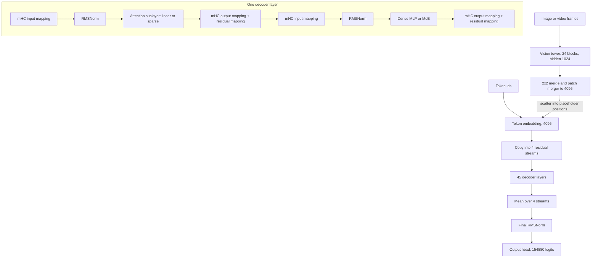

# GLM-5.3-Flash architecture

Source review completed 2026-11-12. Three independent researchers read the
pinned snapshots; the main session combined their reports and spot-checked the
mHC and layer-loop lines. Revisions are in `../../UPSTREAMS.toml`.

Evidence labels used below:

- **Source**: read in the pinned files.
- **Script**: counted by a read-only Python script over `config.json` or
  `model.safetensors.index.json`.
- Nothing was executed against model code or weights. The repo holds no weights.
  Tensor shapes are arithmetic from config values, not read from the checkpoint.

Path shorthand:

| Short | Path |
| --- | --- |
| `M` | `reference/transformers/src/transformers/models/glm5_next/modeling_glm5_next.py` |
| `C` | `reference/transformers/src/transformers/models/glm5_next/configuration_glm5_next.py` |
| `CU` | `reference/transformers/src/transformers/cache_utils.py` |
| `GU` | `reference/transformers/src/transformers/generation/utils.py` |
| `J` | `reference/glm-5.3-flash/config.json` |
| `IDX` | `reference/glm-5.3-flash/model.safetensors.index.json` |
| `card` | `reference/glm-5.3-flash/README.md` |
| `doc` | `reference/transformers/docs/source/en/model_doc/glm5_next.md` |

## Summary

GLM-5.3-Flash is a vision-language model: a 24-block vision tower feeds a
45-layer text decoder. The decoder differs from a standard transformer in four
ways.

1. **mHC replaces the residual stream.** Each token carries four residual
   streams. Every sublayer reads one combined vector and writes back to all four.
2. **Two attention sublayer types alternate 3:1.** 34 layers use linear
   attention (Kimi Delta Attention, KDA) with a fixed-size recurrent state. 11
   layers use sparse attention: an indexer picks up to 2048 earlier tokens and
   attention runs only over those.
3. **No positional encoding in the text decoder.** The code passes
   `position_embeddings=None` (`M:1502-1503`). Order information comes from the
   causal convolution, the recurrent state, and the indexer's pooling.
4. **MoE feed-forward.** Layers 0-2 use a dense MLP. Layers 3-44 use 288 routed
   experts (8 per token) plus one shared expert.

The model card states "320B total parameters and just 18B active parameters"
(`card:25`). No other source gives a parameter count.



## Size and shape

| Property | Value | Evidence |
| --- | --- | --- |
| Class, model type | `Glm5NextForConditionalGeneration`, `glm5_next` | Source: `J` |
| Parameters | 320B total, 18B active | Source: `card:25`, `doc:32` only |
| Decoder layers | 45 | Source: `J` |
| Hidden size | 4096 | Source: `J` |
| Vocabulary (output head width) | 154880 | Source: `J`, `M:2150` |
| Residual streams (`hc_mult`) | 4 | Source: `J` |
| Linear-attention layers | 34 | Script |
| Sparse-attention layers | 11, at indices 3, 7, ..., 43 | Script |
| Dense MLP layers | 3, at indices 0, 1, 2 | Script |
| MoE layers | 42, at indices 3-44 | Script |
| Routed experts, per token | 288, 8 | Source: `J` |
| `max_position_embeddings` | 1048576 | Source: `J:181` |
| Checkpoint | 62 shards, 76,108 tensors, 328,326,771,576 bytes | Script: `IDX` |
| Stored format | FP8 (`e4m3`) for part of the weights | Source: `J:291-292` |
| License | MIT | Source: `card:6` |

The card gives no context-length statement. It mentions "under 1M context" only
in a benchmark footnote (`card:51`).

## Token flow through the text decoder

Each step below is from `Glm5NextTextModel` (Source).

| Step | Operation | Shape | Lines |
| --- | --- | --- | --- |
| Token embedding | `nn.Embedding(154880, 4096)` | `[B, S, 4096]` | `M:1434`, `M:1465` |
| Create streams | Copy the embedding 4 times; no learned projection | `[B, S, 4, 4096]` | `M:1494` |
| 45 layers | Each layer takes and returns all 4 streams | `[B, S, 4, 4096]` | `M:1497-1508` |
| Hyper-head | Unweighted mean over streams; no parameters | `[B, S, 4096]` | `M:332-336`, `M:1510` |
| Final RMSNorm | Applied once, after the mean | `[B, S, 4096]` | `M:1438`, `M:1510` |
| Output head | `nn.Linear(4096, 154880, bias=False)` | `[B, S, 154880]` | `M:2150` |

The output head and token embedding are separate tensors in the checkpoint
(Script: `IDX`), and `tie_word_embeddings` is false (`J:254`).

## mHC

mHC is the layer's only residual path. There is no plain `x + f(x)` in a decoder
layer (Source: `M:1311-1349`).

Each layer owns two independent hyper-connection modules, `attn_hc` and
`ffn_hc` (`M:1297-1298`). Each has these parameters (`M:271-283`):

| Name | Shape | Initial value |
| --- | --- | --- |
| `fn` | `[24, 16384]` | normal(0, 0.02) |
| `base` | `[24]` | zeros |
| `scale` | `[3]` | ones |

24 is `(2 + 4) * 4`: four input-mapping weights, four output-mapping weights,
and a 4x4 residual mapping.

For input streams `X` of shape `[B, S, 4, 4096]` (`M:285-329`):

```text
f     = UnweightedRMSNorm(flatten(X))        # RMS over all 16384 values, float32
w     = f @ fn.T                             # [B, S, 24], split into pre_w, post_w, comb_w
pre   = sigmoid(pre_w  * scale[0] + pre_b)  + hc_eps      # input mapping, 4 weights
post  = 2 * sigmoid(post_w * scale[1] + post_b)           # output mapping, 4 weights
comb  = softmax(comb_w * scale[2] + comb_b, dim=-1) + hc_eps   # residual mapping, 4x4
comb  = Sinkhorn(comb)
h     = sum_n pre[n] * X[n]                  # sublayer input, [B, S, 4096]
```

The layer then applies (`M:1336-1338`, `M:1345-1347`):

```text
y        = sublayer(RMSNorm(h))
X_new[j] = post[j] * y + sum_i comb[i, j] * X[i]
```

Details:

- The three mappings depend on the current hidden state. They are computed per
  token and per layer, not stored as fixed matrices.
- Sinkhorn with `hc_sinkhorn_iters = 20` means one column normalization, then 19
  rounds of row normalization followed by column normalization. The last step is
  a column normalization (`M:321-324`).
- `hc_eps` (1e-6) is added to the input mapping, to the residual mapping after
  softmax, and to every Sinkhorn denominator (`M:313-324`). The config docstring
  mentions only the Sinkhorn use (`C:59-60`).
- The input-mapping weights lie in (0, 1) and the output-mapping weights in
  (0, 2).

## Attention sublayers

The decoder alternates three linear-attention layers with one sparse-attention
layer. Sparse layers sit at every index where `i % 4 == 3` (Script).

### Linear attention (KDA)

Source: `Glm5NextTextLinearAttention`, `M:620-770`.

| Part | What the code does | Lines |
| --- | --- | --- |
| Projections | `q_proj`, `k_proj`, `v_proj`: 4096 to 8192 (64 heads x 128), no bias | `M:639-641` |
| Short convolution | One depthwise causal `Conv1d` over q, k, v together; kernel 4; then SiLU | `M:643-651`, `M:678-720` |
| Decay | `g = -5 * sigmoid(exp(A_log) * (f + dt_bias))`; decay is `exp(g)`, between `e^-5` and 1 | `M:339-369` |
| Beta | `sigmoid(b_proj(h))`, one scalar per head | `M:654`, `M:734` |
| Output | RMSNorm over each head, times `sigmoid(gate)`, then `o_proj` 8192 to 4096 | `M:374-393`, `M:766-768` |

The recurrent update for one token, with state `S` of shape
`[B, 64, 128, 128]` (`M:499-511`):

```text
S      = S * exp(g_t)
kv_mem = sum_k S[k, :] * k_t[k]
delta  = (v_t - kv_mem) * beta_t
S      = S + outer(k_t, delta)
o_t    = sum_k S[k, :] * q_t[k]
```

- q and k are L2-normalized; q is also scaled by `1/sqrt(128)`. The kernel runs
  in float32 (`M:451-487`).
- A one-token step with existing state uses the recurrent form. Everything else
  uses a chunked form with chunk size 64 (`M:737-760`).
- The state size does not grow with sequence length. Each KDA layer keeps one
  recurrent state and one convolution state of shape `[B, 24576, 4]`.

### Sparse attention

Source: `Glm5NextTextAttention` (`M:1101-1276`) and `Glm5NextTextIndexer`
(`M:773-1061`).

The attention itself uses low-rank projections:

| Projection | Sizes | Lines |
| --- | --- | --- |
| Query | 4096 to 1536, RMSNorm, then to 64 heads x 256 | `M:1127-1129` |
| Key and value | 4096 to 512, RMSNorm, then to 64 heads x (256 key + 256 value) | `M:1131-1141` |
| Output | 16384 to 4096 | `M:1143-1148` |

The indexer chooses which earlier tokens each query can see. It runs under
`torch.no_grad` (`M:810`).

1. Build a 128-wide index key per token (`wk`, then LayerNorm) and 32 index
   queries of width 128 (`M:798-800`, `M:834-835`).
2. Group tokens into pools of 4. Each pool key is a softmax-weighted average of
   its 4 token keys. The weights come from a learned gate plus a learned
   in-pool position term of shape `[4, 128]` (`M:967-1004`).
3. Score each complete pool: `relu(q . pool_key / sqrt(128))` per head, then a
   learned weighted sum over the 32 heads (`M:862-867`).
4. Keep the top 512 pools, which expand to at most 2048 tokens (`M:884-901`).
5. Always add the current incomplete pool, at most 3 more tokens
   (`M:903-906`).

Attention then uses a mask that allows only the selected tokens
(`M:1238-1276`). All 45 `indexer_types` entries are `"full"`, so no layer reuses
another layer's selection (Script).

## Feed-forward sublayers

Source: `M:85-206`.

| Layers | Type | Width | Notes |
| --- | --- | --- | --- |
| 0-2 | Dense MLP | 12288 | Gate, up, and down projections, no bias |
| 3-44 | MoE | 2048 per expert | 288 routed experts plus 1 shared expert |

- **Activation.** `down(silu(clamp(gate, max=10)) * clamp(up, -10, 10))`. The
  limit is `swiglu_limit` (`M:101-102`).
- **Router.** Scores are `sigmoid(x @ weight.T)` in float32. Selection adds
  `e_score_correction_bias` to the scores and takes the top 8. The weights use
  the raw scores, are divided by their sum, then multiplied by 2.5, so they sum
  to 2.5 per token (`M:159-181`).
- **Shared expert.** One MLP of width 2048 sees every token. Its output is added
  without a weight (`M:195-205`).

## Vision tower and multimodal merge

Source: `M:1514-2053` and `J:261-279`.

| Part | Value | Lines |
| --- | --- | --- |
| Patch embedding | `Conv3d`, kernel and stride `[2, 14, 14]`, 3 to 1024 channels | `M:1725-1733` |
| Blocks | 24, pre-norm, RMSNorm, 16 heads, non-causal | `M:1687-1713` |
| Positions | Axial 2D RoPE on q and k only; no learned positions | `M:1737-1751` |
| MLP | Clamped SwiGLU, intermediate 4096, with bias | `M:1519-1531` |
| Spatial merge | `Conv2d` kernel and stride 2, 1024 to 4096 | `M:1822-1827` |
| Patch merger | Linear, LayerNorm, GELU, clamped SwiGLU (10240 wide) | `M:1535-1554` |

The merged vision features replace placeholder token embeddings with
`masked_scatter` (`M:1971-1985`). Image and video share placeholder id 154854;
the code tells them apart by the start/end tokens around them (`M:1962-1969`).

The chat template has an audio macro, but the modeling code has no audio path
(`reference/glm-5.3-flash/chat_template.jinja:53`).

## Inference state

Each layer type keeps different inference state (Source: `CU`, `M:1195-1197`,
`M:688-690`).

| Layer type | Stored state | Grows with length |
| --- | --- | --- |
| Sparse attention | 512-wide key/value latents and 257-wide indexer states per token | Yes |
| Linear attention | Recurrent state `[B, 64, 128, 128]` and convolution state `[B, 24576, 4]` | No |

- The recurrent state is overwritten in place on every step (`CU:1242-1246`).
- Cropping a linear-attention cache layer slices only the convolution state and
  never restores the recurrent state (`CU:1132-1151`). The cache reports itself
  as not croppable once a recurrent state exists (`CU:1107-1112`).
- The model sets `_is_stateful = True` (`M:1367-1370`), and `generate` rejects
  assisted generation for stateful models (`GU:1865-1876`).

This matches the state-recovery section of `../target-contract.md`. Rolling
back rejected draft tokens needs a state snapshot or a replay.

## Checkpoint contents

Script over `IDX` and `J`, unless marked.

- **MTP block.** The checkpoint has a 46th block, `layers.45`, with 1760
  tensors. It includes `eh_proj`, `enorm`, `hnorm`, and `shared_head.norm`, and
  has no mHC tensors. The model ignores it on load (`M:1379`). The doc page says
  the implementation "does not include an MTP layer" (`doc:26`). Calling block
  45 the MTP block is an inference from the key names and
  `num_nextn_predict_layers: 1`.
- **FP8.** 37,338 `weight_scale_inv` tensors exist. They sit only on dense MLP
  weights, MoE expert weights, and four sparse-attention projections. The
  linear-attention layers, mHC parameters, norms, router, embeddings, output
  head, and vision tower are not quantized.
- **Tensors per layer.** 29 for layers 0-2, 1762 for sparse-attention layers,
  1759 for the other linear-attention layers.

## Open questions

These could not be settled from the pinned files.

| Question | Why it is open | What would settle it |
| --- | --- | --- |
| Does the Hub label `deepseek_sparse_attention` load? | The code keys its mask dict and cache-layer mapping on `indexed_attention` only (`M:1489-1500`, `CU:1376-1395`). The config class rewrites only `full_attention` (`C:170-172`). By source reading both lookups raise `KeyError`. | Build `Glm5NextTextConfig` from `J` at the pinned revision and inspect `layer_types`, or run a small forward pass. |
| How are checkpoint names mapped to module names? | The checkpoint uses `hc_attn_fn`, per-expert `experts.E.gate_proj`, and `q_conv1d`/`k_conv1d`/`v_conv1d`. The modules use `attn_hc.fn`, fused `gate_up_proj`, and one `conv1d`. No mapping is in the snapshot. | Read the loader or conversion mapping at the pinned revision. |
| How is FP8 consumed at load? | The modeling file has no handling for `weight_scale_inv`. | Read the quantizer code at the pinned revision. |
| What do the Hub kernels compute? | KDA and the convolution are decorated to use Hub kernels, with the Python code as fallback (`M:462`, `M:516`). | Compare kernel output with the fallback on the same input. |
| How is the MTP block wired? | No pinned source defines it. | Read a backend that implements it. |
| Which config keys are inert? | `mhc`, `scoring_func`, `topk_method`, `moe_router_dtype`, `first_k_dense_replace`, `num_nextn_predict_layers`, `index_kpool_compress`, `index_share_for_mtp_iteration`, `indexer_rope_interleave`, `mla_use_nope` are not read by the model code (Script). Whether the config class stores or rejects them is outside the snapshot. | Load the config at the pinned revision. |
| What is the parameter count? | The index has no shapes. | Read safetensors headers from the Hub. |

The first question is already tracked in the compatibility section of
`../target-contract.md`. This review adds that the cache-layer mapping has the
same gap as the mask dict.

## Notes for the drafter

- Context features taken at a layer boundary are four streams per token. The
  approved baseline uses the unweighted stream mean, which is the same operation
  the hyper-head applies at the end.
- The final RMSNorm runs after the stream mean. Teacher logits need that norm
  exactly once.
- The indexer is not differentiable (`torch.no_grad`). This matters only if a
  later experiment trains through the target.
